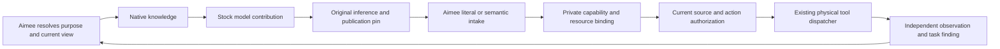

Publication correction — 2026-10-17: the historical public PR #3026 was withdrawn, its branch reset and deleted. Keep this research private. The experimental implementation and exact evidence are preserved in the companion private evidence bundles. Historical PR-status statements below describe the original run, not current publication status.

# Native tooling: five follow-ups, Aimee implementation and CPU evaluation

This evaluation extends the existing native memory mechanism. It does not investigate a new attention mechanism, train tools into a model, or introduce a reasoning expert. Stock Gemma4 E2B is the primary task model; Qwen3 0.6B is a small control. Both run on CPU-only vLLM 0.30.0 on owned CTs on .253. No GPU and no .100 research host is used.

**Status: all experiment cohorts terminal; implementation is in draft PR3026.** Raw observations, failed launches, source snapshots, scoring code and SHA256 manifest are preserved in `benchmarks/native_capabilities/evidence/20261014-native-tooling-five-followups/`. CI status is retained separately; local qualification does not imply every remote check has completed.

## What the results support

Aimee can select the current contribution purpose, supply its knowledge natively, bind model-produced content to a resource, and own authorization, execution and observed results. A model need not nominate operations that Aimee already knows are mandatory. Nor does it need OS paths, implementation details, authority decisions or revision ordering in its ordinary prompt.

This implementation accepts one semantic component and one canonical action association per contribution. Mixed reports and alternative or unavailable source requests remain unresolved in this cohort; it does not yet implement a general multi-need plan.

There are two distinct intake routes. An owner-selected typed contribution can use a strict literal contract. General natural-language needs require reliable semantic interpretation. The latter is not supplied merely by a JSON grammar, and weak models currently fail both interpretation and task reasoning. Successful native transport must not be reported as successful autonomous task completion.

| Follow-up | Delivered | Qualification boundary |
|---|---|---|
| Automated intake | Owner stage, strict literal contract and general semantic backend | General classification is unreliable on these weak models |
| Owner/dispatcher integration | Immutable pins, atomic canonical action association, source/identity gates, private host API | Real PostgreSQL transactions and C fixture tests; enrolled complete loop remains unqualified |
| Persistent CPU serving | Actual native vLLM, opaque revision distribution, withdrawal/drain, private capture | Gemma4 E2B and Qwen3 dense, declared single-worker CPU profile |
| Additional needs | Four-domain native/reference cohorts, owner compilation and returned evidence | Successful network requests; ambiguous/mixed needs and task completion remain weak |
| Long-run measurements | 24-turn three-arm controls, in-flight state/RAM, cancellation, output and file verification | Narrow synthetic tasks; preparation and interpreter costs are separate |

## Aimee changes

Implementation is in `/home/virant/dev/aimee-native-tooling-owner`, branch `research/native-tooling-owner-20261014`, rebased onto testing base `6cd6e1d58`. The native implementation commit is `e3374c410`; `91ca4dc97` fixes one mutable config-parser pointer for GCC16/C23. `df6c2202c` registers both dispatcher tests in the official suite and corrects the process stage name; `e781d6ef1` refreshes the reviewed application source snapshot, and `ace7f2245` isolates PostgreSQL tool-policy fixtures from the launch directory. The original experiment implementation was recorded at `faea2889e` before rebase. `53c9989dd` completes the governed egress handoff, schema registration, generated docs and formatting; `db43141b4` verifies real egress HTTP framing, policy and intake interoperability with a fixture bus identity. `cda87a4a0` rejects malformed native pins, duplicate keys and case aliases before private control or native dispatch; normal and sanitized tests and the full server build pass. All commits use registered Aimee Git. The branch is an isolated checkout; unrelated working changes were preserved.

* Aimee's owner module serves host-only asynchronous interpretation on stage 24 / event 11800. Deployed interpretation transport goes through the existing egress process, under dedicated request-only identity 76 and an exact operator-configured destination; the owner opens no network sockets. Missing grants, undeclared credentials or an absent transport leave intake unresolved. Its bounded queue and polling avoid retaining a bus handler while inference runs. A backend's response remains untrusted proposed content. Exact unique UTF-8 excerpts, original bytes, task association and unsupported claims are retained; malformed, duplicate-key and nonterminal output is refused.
* DB1 operation 11 in the guardrail family persists full publication views, immutable inference pins, terminal contributions, intake and canonical action associations. Migration 44 adds a bounded journal. A session directory lock verifies ownership. Revision labels are opaque. Old contributions retain their original view; applicability compares the complete current view, not a guessed newest revision.
* Private capability bindings select the tool, fixed resource and argument mapping. They never enter the semantic resolver's prompt. Compile checks prevent model excerpts from replacing a fixed resource. The canonical action and native pin association commit in the same transaction. Retries reuse an action ID; changed arguments, stale publications and missing current memory guards refuse dispatch.
* C host glue uses the existing memory source-release/send guard and canonical dispatcher. The reserved `native.tooling` command is available only on the authenticated local host control lane. Model-supplied resolve/action operations are refused. `native_pin` scopes physical dispatch. A changed request cannot fall back to ordinary dispatch; every native call requires a canonical owner adapter, including otherwise unclassified tools.
* An explicit `scalar_integer` contribution contract binds one content capability and one required integer field. It accepts a whole literal integer with no semantic backend call. It cannot extract a number from prose, infer another subject, repair a candidate or choose a tool. It preserves the original value and remains subject to owner checks and authorization. Literal text encoding can record the value in a proposal artifact.

This is implemented support and research qualification, not a claim that the complete enrolled serving-to-owner-to-dispatch chain has passed live authentication tests. PostgreSQL tests use explicit synthetic guard fixtures; C tests exercise the real host/dispatcher code with mocked transport and memory responses. Those boundaries remain visible in the evidence.

## Experiment conditions

The original 22-case intake challenge is a development cohort from v99. Its references were excluded from inference. Unconstrained owner responses, JSON schema versions, a general speech-act protocol and a corrected discriminant-first schema are separate conditions. Earlier failures remain preserved. A grammar language control showed valid action JSON was rejected in the original property order but accepted in schema order or any-order mode. A corrected forced-output control established branch viability; it did not establish semantic accuracy.

The persistent CPU profile uses stock checkpoint revisions, FP32 CPU tensors, eager synchronous single-worker serving and no ordinary prefix caching. It reuses publisher withdrawal, quiescent activation and completion ownership. CPU packed K/V cannot be gathered as an ordinary tensor layout; the profile preserves upstream cache updates and keeps a separately measured raw text K/V copy. Native bank memory and this additional text copy are reported separately. Model parameter version checks and bank fingerprints remain unchanged across serving cycles.

Lifecycle cohorts use six owner-distributed revisions in deliberately nonlexical order, repeated colour requests, native/ordinary mixed batches, withdrawal and private-capture denials. A separate in-flight experiment preserves the original bank while withdrawal blocks new requests, tests bounded drain and activates the next view. Cancellation requires a supervised restart before redistributing a fresh bank.

The long-run cohort has 24 turns and three arms: native current view, identical ordinary token prefix, and growing ordinary history. The current-prefix arm isolates native transport. The history arm additionally benefits from owner state compaction; it cannot attribute its entire reduction to native tooling.

Additional-need episodes cover synthetic packing, networking, storage and rendering tasks. Declared standard prerequisites are supplied up front; optional additional sources are available by semantic name. The oracle does not enter inference. The original condition uses a generic contribution cue. A separate development condition adds a general contribution instruction, owner-restricted speech acts, per-source semantic capability routing and actual Aimee compilation. A further budget condition raises the task output limit from 128 to 384 tokens because E2B responses were truncated before a complete contribution. Its first E2B run completed both packing arms, then timed out at a 240-second HTTP deadline. The failure is retained. A supervised restart resumes only unfinished episodes with a 900-second request deadline and the same token budget.

Scalar episodes ask for candidate values under visible interval/parity requirements. Aimee validates the literal and compiles it without another model call. A checker rejects unsuitable values; only eligible candidates produce fixture proposal files with exact independent readback. A feedback cohort distributes actual rejected-candidate findings natively for at most three attempts. The harness never supplies a replacement answer. File effects are research fixtures, and a recorded proposal never implies external project execution.

## Results

The 22-case development intake challenge separates syntax from semantics. Unconstrained E2B validated 0/22; the first schema condition validated 10/22 with no actionable result. The earlier speech-act condition validated 22/22 but produced two false usable decisions. After the discriminant-order correction, E2B validated 21/22 with one bounded timeout and two actionable decisions; both used `need` where the reference expected authored `content`. Ten of twelve usable proposals were missed. Qwen validated 22/22 and abstained on all cases, missing all twelve usable proposals. Invalid intake is not counted as correct semantic classification. Structural forced-output controls only establish grammar viability.

E2B's 24-turn run returned the correct colour in all 72 responses across the three arms. All 24 native/current-prefix pairs have identical token outputs. Native ordinary prompts remained 17 tokens; current-prefix prompts were 63–64 tokens. Across 24 calls the respective ordinary prompt totals were 408,1526 and21165 tokens for native, current-prefix and growing history. The final history prompt was 1,708 tokens. Native banks in this cohort were at most 4,042,752 bytes. These figures do not establish an effective context multiplier or general task competence. They count ordinary task-request input, not all model work: native publication preparation tokens and successful owner interpretation prompt/output usage are recorded separately. Aborted owner calls may have no returned usage, so the aggregate does not claim an exact total for interrupted inference. A prepared bank retains tensor memory and must be rebuilt when Aimee distributes a different view.

Qwen also returned 72/72 correct colour answers and 24/24 exact native/current-prefix token matches. Native/current-prefix/history ordinary prompt totals were 480/1574/19319, with a final history prompt of 1,545 tokens. Both models' repeated lifecycle cohorts returned 48/48 correct colours, six withdrawal 503 responses and six capture-control 403 responses each.

E2B's scalar route accepted and compiled 16/16 complete values with zero owner backend calls, and 12/16 met the visible requirements and produced exact-readback fixture files. The values 15, 5 and 44 were generated by the model rather than supplied as replacement answers. The even-number task produced25 and was rejected. Its feedback cohort accepted 28/28 literal values and completed 12/16 episodes; the odd-number task corrected an invalid first value after actual checker feedback, but the even-number task remained unsuccessful.

For E2B's eight native scalar calls, ordinary prompt tokens totalled 144, compared with 732 for the eight identical-prefix controls; output tokens were 22 in each arm. Its 14 native feedback attempts used 252 ordinary prompt tokens versus 1,702 for the matching controls; outputs totalled 40 tokens in each arm. Both cohorts used zero owner inference calls. These are reductions in ordinary prompt input for the declared tasks, not an enlargement of the model's context capacity. General semantic intake separately incurs owner prompt/output tokens, retained per arm in the aggregate.

Qwen's scalar route accepted and compiled 16/16 complete integer contributions with zero owner backend calls. Only 4/16 met the numerical task requirements; invalid candidates were blocked. The feedback cohort accepted 40/40 literal contributions but completed only 4/16 episodes. Native and ordinary controls made the same persistent reasoning mistakes. Correct intake is not correct candidate generation.

The terminal E2B 384-token condition recorded a native semantic request for "measured useful throughput". Aimee compiled its private read binding and returned the synthetic value `52MB/s`; the model supplied no operation or path. After native distribution of `52MB/s`, E2B revised its assessment correctly: the link cannot sustain the requested `70MB/s`. It then asked for the installation date to investigate the cause, which Aimee also resolved and read. The network native episode ended after three contributions: two accepted reads, then an unresolved request for unavailable sources. Its final binary assessment remained correct, but its stated percentage was internally inconsistent (57.8% alongside a ratio near 0.74), and no assessment file was compiled. Both network arms behave this way. Both storage arms again request alternative sources and receive unresolved owner decisions. Rendering also remained unresolved in both arms. Across eight episodes, two discovered the needed source, four reads were accepted, and zero reports were compiled. Native and ordinary arms each made six task calls, with identical output-token totals of 1,570. Their ordinary prompt totals were 198 versus 877; each arm additionally used 3,710 owner prompt tokens and 683 owner output tokens. General interpretation therefore has a substantial separate context cost. Both packing arms instead received an inconsistent owner `none` decision despite its explanation recognizing a need. These observations belong to a development cohort, and the source names were listed as available.

The Qwen original additional-need cohort produced no accepted lookups or reports in 16 episodes. The compiled follow-up recorded four proposed reports but no additional source reads. These records do not establish correct assessments. The original task outputs contain arithmetic errors, unjustified completion claims and premature assessments. In the terminal Qwen 384-token condition, eight episodes produced no accepted lookup and two fixture reports, with assessment correctness unproven. E2B's earlier 128-token conditions completed 16 episodes each but every response ended at the output limit, so no terminal contribution was accepted.

Both in-flight cohorts withdrew with one active request, blocked a new request with 503, retained the old bank through its terminal response and activated the next view after drain. Preparation while busy timed out within the declared five-second bound; after drain it succeeded. Sampled process-group memory peaks were 36,864,679,936 bytes for E2B and 8,628,350,976 bytes for Qwen. Separately measured raw text shadow-cache peaks were 3,170,304 and 20,414,464 bytes. Final shadow occupancy was zero and parameter version audits remained unchanged. Full tensor-hash instrumentation perturbs latency; these are lifecycle/RAM observations, not performance benchmarks.

Collected actual proposal artifacts match every recorded effect: 24 E2B and 14 Qwen files/records have matching SHA256 and exact compiled content. This is independent artifact verification; it does not certify the assessment's reasoning.

The real PostgreSQL test passes 24 concurrent attempts to obtain one immutable pin and 12 concurrent reissues retaining one canonical action ID. It refuses changed resources, missing memory guards, cross-principal access and dispatch after withdrawal. One dispatch permission produces an independently verified fixture file; repeat dispatch is blocked, and historical receipts remain readable after withdrawal. The automatic scalar route is included. Source release and guard values in this test are fixtures, not enrolled authorization.

## Validation and evidence limits

Core Go race tests, owner construction/registration, descriptor/source ownership and DB1 client contract checks pass. The full C server linked under GCC16. Testing already contains the mutable Git CLI pointer fixes needed by the default dialect; mutable config-parser and Git upstream-buffer pointer fixes make the rebuilt default-dialect full server pass. Official native and governed-action unit targets pass normally and with AddressSanitizer/UndefinedBehaviorSanitizer. The config-parser regression test and application source-lock regression tests pass. The original-base module boundary comparison reports 75 existing violations and zero new ones. After the testing rebase, the checker reports 81 violations; the native owner uses its own package and bus wire, with no new peer implementation import. The egress boundary, schema inventory and process contract checks pass.

The CPU-compatible existing plugin suite ran 83 tests: 59 passed and 24 skipped. Two GGUF-dependent test modules were excluded after the full suite failed to import the unavailable `vllm_gguf_plugin`; these models use safetensors. Three new CPU control tests pass. Local broad regression runs initially lacked Go on PATH and the built thin-client binary. A later document-hook fixture correctly refused a Git path because an existing `/tmp/.git` marker encloses the default temporary directory. All 66 discovered script regression files have passing runs across preserved segments. The four initially failing lint targets—egress, schema synchronization, generated docs and formatting—now pass through their official Make targets. The unchanged 28-case thin-client suite passes under `/var/tmp`; the marker and hook policy remain untouched. Failed invocations are retained.

Both models completed cancellation checks. E2B entered `restart_required`, underwent a supervised restart of its owned CPU service, accepted a fresh publication and answered `Cerulean` correctly. Both owned model services are stopped after final collection; their CTs and read-only checkpoints are retained.

Cancellation exposed misleading CPU metrics reporting `active` while status required restart; the local fix preserves the original frozen serving evidence.

Startup launcher errors are preserved as failed controls. A quoting error and an incorrect wait for HTTP health delayed E2B tests: HTTP health deliberately remains503 until the publisher activates a bank. Publisher readiness uses its private control socket. These attempts generated no qualified canary samples. The independently initialized long-run cohort is retained as its own actual serving condition.

The isolated checkout was initially outside the registered Git workspace. It has now been registered and served as a detached workspace, and Aimee Git status resolves the correct feature branch. Registered verification resolves the right path but still reports its Makefile unavailable on the remote server; local full builds and targeted checks pass. No connector writes, attribution trailers or review-setting changes were made. The implementation commits are recorded above; [Draft PR3026](https://github.com/RakuenSoftware/aimee/pull/3026) is open against testing. Automatic review settings remain enabled.

## Repeatable qualification process

1. Freeze the stock checkpoint revision, serving configuration, native adapter source, owner implementation, task publications and scoring references. Keep references out of model and interpreter input. Record CPU-only runtime and source hashes.
2. Have Aimee select the task purpose, usable contribution contract, private resource bindings and resolved publication. Bind inference to that full publication before generation. Transport its knowledge through the existing native memory path; the adapter performs no semantic or revision selection.
3. Preserve the full terminal contribution. Route a complete owner-selected literal through strict intake; route general semantic content through owner interpretation. Refuse truncation, ambiguity, invented excerpts or absent associations. Count owner interpreter context separately.
4. Compile only against the pinned private bindings. Recheck the current source release, identity, task applicability and policy in the canonical action path. Persist one action association before dispatch. Observe effects independently and distribute actual task findings through Aimee; never substitute a repaired candidate for model output.
5. Run identical ordinary-prefix controls, withdrawal/in-flight tests, cancellation/restart, opaque revision changes and repeat replay checks. Score valid intake, correct task reasoning, accepted additional needs, authorized dispatch and observed completion separately. Preserve failed launches and interruptions before resuming unfinished cases. Seal the raw records, implementation snapshot and manifest after terminal collection.

The initial useful scope is owner-directed workflows with known operations and typed contributions. Promote general semantic routing only after held-out paraphrase, ambiguity, unsupported-claim and source-conflict evaluations pass. A model can identify a useful source while the owner interpreter still fails; those are separate defects. Temperature-zero repetitions are reproducibility checks, not independent statistical samples.

## Research options

1. **Aimee directs known operations and binds contributions before inference.** This is the strongest supported base. Extend strict generic contribution types, task predicates, result capsules and source-bound recovery. Evaluate useful complete tasks, not merely accepted values.
2. **Aimee resolves general semantic needs.** Keep interpretation inside the owner and compare more capable stock interpreters or existing semantic services. Freeze held-out ambiguity, scope conflict, unsupported-claim and paraphrase cases. Measure mistaken routing and missed needs independently of syntax. This requires reliable interpretation, not per-tool model training.
3. **Evaluate reasoning improvement separately.** Literal intake can succeed while parity reasoning, need discovery and use of checker feedback fail. Phase2 adaptation may improve those abilities, but this experiment does not test weight plasticity and does not require it to define the authority or tool contract.

Next qualification must couple actual serving inference/publication identity, enrolled memory release, automatic owner intake, canonical physical dispatch and independently observed effects in one deployed loop. Longer task runs should include cancellation, revoked source/policy, ambiguous needs and repeated failures. Broader model families can reuse the control contract through their existing native memory integration, but current CPU serving evidence covers only the declared Gemma4/Qwen3 adapters.
