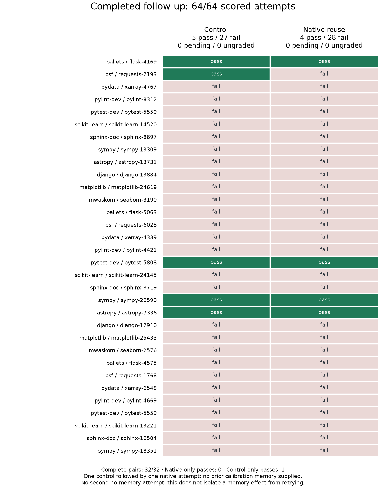

# Monday release work record

Target: Monday morning, 2026-09-28, Europe/Amsterdam. This is a live work record,
not a declaration that the release gates have passed.

## Current recommendation

The 12B signed candidate has passed the recorded runtime, source-memory
regression and signed install/update/rollback/restore checks. These support a
limited private preview of that tested candidate, with the measured learning
scope stated explicitly. They do not establish general SWE-bench improvement:
the original broader study remains 5/32 control versus 4/32 native, with its
one lost case subsequently repaired in a separate targeted experiment.

The requested three-model release is **not ready**. Gemma 26B Q8 now passes
baseline 4/4 and native smoke 5/5 using the supported Triton matrix backend.
Its compiled-image HTTP check also passed all 60 memory-backed requests
(46 native, 14 text); four no-memory controls lacked the synthetic facts.
Qwen 27B Q8 passed its four packaged GPU baseline smoke checks.
Qwen's first native/text/control smoke completed at 3/5, 5/5 and 1/5 respectively;
a separate negative-position comparison now passes 5/5 native and 5/5 text.
Both original misses remain recorded. Qwen's packaged HTTP validation now
also passes all 60 memory-backed requests (46 native, 14 text). Both larger
profiles pass live canary preparation, reuse, expiry, withdrawal, publisher
disconnection and recovery checks. Neither larger model has completed
release native-memory or signed lifecycle validation. See the
[larger-model validation report](larger-model-native-20260928.md).
The normal published channel remains at sequence 5.

Completed evidence: [10/10 selected regression attempts](artifacts/retained-success-validation-20260928/status.json),
[8/8 signed lifecycle queries](artifacts/normal-signed-lifecycle-20260928/lifecycle-summary.json),
and [targeted Requests comparison](artifacts/requests-literal-task-20260928/final-status.json).

## Completed primary study and current handoff

The primary campaign completed all 64 scored attempts. Control passed 1/16;
each native round passed 2/16, with one unique gain retained in all three
rounds and no loss of the sole passing-control task. The complete report,
outcome matrix and evidence links are in
[source-learning-primary-20260928.md](source-learning-primary-20260928.md).
The 281-file archive is verified. The final delivery audit passed for 1,474
requests, 64 trajectories and 39 publications.

The separate 32-task follow-up and all official grades are complete. The
original results are preserved alongside the targeted Requests repair and
selected retained-success checks. No release promotion has occurred.
The historical sections below preserve earlier checkpoints and interventions.

## Current release candidate

Image: `7303c9e9b0785a8574885594aafe87d8f65b54acdf3a3c20a003901be5f40605`.
Registry digest: `sha256:1fc9a828331c42da146be2a9fcd1171e67c67dc8bf5167052c854ee7916822ea`.
Artifact set: `194784c37a063b79e737aea66a45d749c24f3cf65f8186500613cd5660cb106d`.
Lab candidate manifest: `b05aff4bea742a32f53d5b09641b7f8ee99aee9b67bd73ebb80070fd188314ea`.
The image is unchanged; the staged disk budget was corrected to 2 GiB.

This supersedes the candidate IDs in the chronological work record below. It
includes the corrected attention bank, retryable long refresh drains, aligned
caller deadlines, and responsive health/withdrawal during refresh. Generation
checks prevent a superseded refresh from reopening admission, including when
withdrawal arrives during the worker RPC. All 27 compiled runtime checks pass.
The client candidate verifies all 18 artifact hashes and uses the rebuilt Rust
lab launcher. Standard and 32-record GPU certification passed, and hosted FP32 preparation
is deployed pending client validation. All nine corrected FP32 reuse cases passed. Installed model-answer validation,
automatic restart recovery, and served FP32 computation audit also passed.
The targeted learning regression is repaired, all ten selected retained-success
attempts passed, and the normal signed lifecycle passed all four phases. Larger
model validation remains outstanding; these results apply to the 12B candidate.

The broader campaign is now **complete: 64/64 scored attempts**. Control passed
**5/32**, native reuse passed **4/32**: four both-pass, twenty-seven both-fail,
one control-only pass and no native-only pass. The regression is
`psf__requests-2193`. This follow-up does not demonstrate a task-success gain;
it identifies a remaining source-procedure reproduction failure. It remains a
release blocker for the learning claim, regardless of passing recall checks.

The final archive contains 252 individually verified evidence/source files plus
its checksum manifest. The final delivery audit passed **1,233 calls across
64 trajectories and 31 publications**, without memory text in the model prompts.
See [the final report](source-learning-broader-20260928.md). Historical interim
checkpoints, original infrastructure failures, and regrades remain preserved.

[Vector PDF of the final outcome matrix](artifacts/broader-source-learning-20260928/final-outcomes.pdf).

The four completed successful pairs show procedure reuse:

| Task | Control calls | Native calls | Control agent seconds | Native agent seconds |
|---|---:|---:|---:|---:|
| Flask-4169 | 6 | 2 | 61.2 | 13.4 |
| Pytest-5808 | 22 | 4 | 300.3 | 27.5 |
| Astropy-7336 | 6 | 5 | 70.7 | 43.7 |
| Sympy-20590 | 24 | 7 | 381.4 | 68.6 |

These are observed agent durations under concurrent load, excluding acquisition
and memory preparation. They are not isolated application-latency measurements
or evidence of additional solved tasks. No new no-memory retry condition has
been run to isolate the effect of receiving a second attempt.

## Required closure

| Requirement | Current authoritative evidence | Remaining work |
|---|---|---|
| Automatic learning preserves successful source experience | `source_experience.py`, exact-patch replay gate; primary 64/64 outcomes complete | Completed: one lost task, no new gains; correct and validate procedure reproduction |
| Generated summaries do not silently replace working procedures | Source records retained without generated summaries; primary delivery audit passed | Final follow-up audit passed 1,233 calls; investigate generation-level corruption |
| Native memory adds usable capability | Primary one unique gain retained across three rounds; sole control pass preserved | Broader study complete, 5/32 control versus 4/32 native; learning release claim not cleared |
| All selected records consumed, no silent truncation | Primary 1,474-call and follow-up 1,233-call delivery audits passed | Complete exact-image multirecord gates |
| Corrected attention ships in the artifact | Candidate built from release-5 image with corrected compiled bank, original dependency set | Exact-image serving, isolation, long context, pressure, lifecycle and disclosure checks |
| Signed install/update/rollback works | Existing release-5 live lifecycle evidence | Validate the new candidate and sign/promote only after its gates pass |
| Private implementation remains private | Final installed package source audit and 18-artifact client verification passed | Preserve binding to final signed artifacts |
| Results are reviewable | Frozen protocols, hashes, raw trajectories and official outcomes | Archive completed evidence, update recommendation and push |

## Initial job configuration (historical)

CT113 `/opt/swe-native/lesson-fidelity-20260927` completed the fixed eight-cell
single-task diagnostic (six resolved, two failed). Its preparation outage is archived independently and
was resolved by restoring the same diagnostic FP32 resident compiler. It is not
counted as a failed model attempt.

CT113 `/opt/swe-native/source-learning-20260927` is running 64 attempts with two concurrent agents and automatic source-backed capture.
A no-memory control and three native-learning rounds use identical inference
budgets and editing tools. Successful historical calibration learn-1 experiences
are explicitly identified as prior experience. The experiment does not claim
held-out-task generalization.

CT101 `/opt/aimee-memory-lab/release-candidate-20260927` stages the corrected
compiled attention bank into a new immutable image. It is not a signed or
promoted customer release. The shared GPUs remain assigned to learning until
that job finishes; certification must not silently perturb its conditions.

## Explicit boundaries

The learning fixture's official success boolean is not production authorization
or a general procedure validator. Aimee remains authoritative for scope and
publication. A benchmark loop alone does not establish production learning
integration. Existing private-preview scope, cold-activation performance limits,
and public-redistribution source/notice obligations are not erased by a successful
learning result. The final recommendation must identify any unmet requirement
rather than converting a passing subset into an unconditional release claim.

## Candidate staging and live delivery check

The candidate is staged, not promoted, at immutable registry digest
`sha256:9deeb8f1f672c2b02269209ebe78ec712aa0422a5aa26c011c1528644377571e`.
Its image configuration ID is
`8f4503539e29413520e27638f957c573c2e09e99fe219119a921f63deb1ac119`.
Seventeen compiled control/admission/streaming checks passed. The contents audit
finds only the four manifest-referenced kernels and their metadata, and no private
Python/Cython/C implementation files in the installed consumer package.

The staged runtime profile uses an 8192-token context, 512 MiB native-device
budget and 2 GiB native-host budget. Standard and 32-record certification are
queued for that context with the same 0.8 GPU utilization as the learning run.
These are candidate settings awaiting GPU and installed-client validation.
The expected artifact-set identity is recorded; unchanged artifact hashes come
from signed release 5 and must be rehashed by the final package assembler.
No passing release-gate records or signed manifest have been fabricated.

The existing enrolled client successfully fetched all three approved canaries
for the explicit native-release verification query in 0.31 seconds. This is
control-plane delivery, not inference latency. A separate generic private-vault
query selected one record and took 48.45 seconds; that is retained as a different
selection result, not claimed as a successful three-record retrieval. The final
installed runtime probe must use the declared three-canary verification query
and check all three answers. Evidence resides in
`artifacts/release-candidate-20260927/`.

The separate client candidate installation verifies all 18 artifact hashes and
matches the expected artifact-set identity. Its manifest is explicitly lab-only,
used with the existing candidate-test launcher; the signed release-5 installation
is unchanged. Candidate staging and tamper-rejection tests pass. After learning,
the operator queue runs standard image certification, the 32-record workload,
and the enrolled candidate client's three-canary model-answer probe, in that
order. It stops on a failed stage. This queue does not sign or promote a release;
normal signed installation, update and rollback still follow successful gates.

## Automatic acquisition replay check

The separate CPU-only check recovered both successful calibration trajectories
without hand-selecting their commands. Flask's executed edit replayed exactly
on the first trial. Matplotlib required three replay trials and used the full
own-patch fallback; its resulting diff matched the previously successful patch
exactly. No generated summary or reference solution was used. These are two
acquisition checks, not two new model solves or a general learning success rate.
The raw source-experience records, replay observations and report are preserved
in `artifacts/swe-lesson-fidelity-20260927/source-acquisition-check.tar.gz`.

After eight scored campaign attempts, neither of the first two tasks resolved
in control or any native round. No infrastructure errors were recorded. Those
results remain failures; successful procedure acquisition alone does not prove
that the model will use a record effectively. The remaining pairs are running.

The exact-image test now includes eight additional long-context requests: two
independent three-record banks, native/text delivery, and prompt targets of
4096 and 7168 tokens. The server tokenizer establishes each actual length, and
inference usage must agree. All three selected values must be recalled in each
answer. These probes are queued, not yet passed; merely configuring an 8192-token
server does not certify behavior near that limit.

## Preparation-path mismatch found and staged correction

The source-learning campaign uses the diagnostic FP32 resident compiler and
`native-swe-v2-fp32`. The enrolled live client still used the production BF16
compiler and `native-negative-v1`. A corrected consumer image alone therefore
does not reproduce the combined repair exercised by the learning campaign.

The queued operator upgrade runs only after learning and both image checks pass.
It backs up the original service files/configuration, stops the two resident
copies before loading production FP32, updates the one-shot fallback as well,
and changes live preparation to `native-negative-v2-fp32`. This changes cache
identity without changing source authority or account bindings. Failures restore
the prior compiler and preparation configuration. Two isolated tests cover the
upgrade and rollback paths; actual service migration and client validation remain
pending. The queue must not count the old BF16 client route as combined-repair
validation. Implementation remains private in `distribution/tests/upgrade_preparation.py`.

## First completed task block (partial campaign)

All four conditions finished for the first four frozen tasks: astropy-13438,
pytest-9475, django-11377 and scikit-learn-12557. All sixteen attempts failed
their task; none was an infrastructure error. No task gain or regression relative
to a successful control can be claimed from this block because every control
also failed. This does not establish useful automatic learning. Full trajectories,
publication facts, patches and outcomes are retained in
`artifacts/source-learning-20260927/first-four-tasks.tar.gz`; the adjacent JSON
contains the per-attempt exit statuses and durations. Twelve tasks remain in the
running campaign. The next block includes a prior validated Matplotlib procedure.

## Output-budget observation and follow-up support

The installed chat template explicitly honors `enable_thinking=False`; the
observed truncations cannot be attributed to an ignored thinking-disable option.
In the Matplotlib control, six of the first eighteen model calls reached the
512-token response cap, including an ordinary Python source-edit command cut
off before its closing fence. This is a harness limitation to investigate, not
proof that increasing the limit fixes task accuracy or native-memory regressions.

`SWE_OUTPUT_TOKENS` now permits a separately declared output budget (default 512,
maximum 4096). The runner reserves matching space inside its 8192-token context
and records both input/output budgets; all delivery conditions use the same
rule. Six protocol checks pass in an isolated CPU-only test directory. The
active 64-attempt campaign's deployed scripts and 512-token budget are unchanged.
No larger-budget GPU result is claimed.

## First native task gain (partial campaign)

Matplotlib-25340 failed without memory (repeated formatting errors, empty patch)
and passed official grading in native round one. The model made four calls:
it attempted a reproduction, applied the retained patch, attempted the
reproduction again, and submitted. The submitted patch's SHA-256 exactly matches
the source experience accepted by automatic independent replay. Acquisition used
the full own-patch fallback after three replay trials; no hand-written command
or hidden reference patch was supplied.

The acquired procedure came from the explicitly declared prior calibration
success, so this is successful source-experience reuse, not discovery of a new
solution during the current campaign. Agent wall time was 109.6 seconds, which
includes tool execution and is not memory-application latency. Later rounds and
the other tasks remain pending. Raw control, acquisition, native trajectory and
official outcome are in `artifacts/source-learning-20260927/first-native-gain.tar.gz`.

The final queued preparation check requires actual compiler job telemetry after
the service migration and passing client probe. It rejects an empty log, BF16
computation, or a window containing only reused preparation with no newly
evaluated tokens. The live diagnostic compiler confirms the expected telemetry
fields (`compute_dtype`, `evaluated_tokens`) exist. Three isolated acceptance/
rejection checks pass, and the two migration/rollback checks still pass. This is
an operator-side evidence check, outside the inference hot path. Its live result
is pending. The pinned `runtime_commit` remains the unchanged upstream vLLM
commit; the immutable candidate image separately identifies the corrected kernels.

Matplotlib subsequently passed native rounds two and three as well: **0/1 control,
3/3 native rounds**, four model calls per native attempt, and the exact acquired
patch each time. The complete task case is retained in
`artifacts/source-learning-20260927/matplotlib-retention.tar.gz`. Publication and
fact bytes were unchanged between rounds, and the learner explicitly retained
the accepted success. This demonstrates repeatable procedure reuse for this
task; it is not three independently learned tasks or evidence that successive
rounds discovered a better solution. The remaining campaign is still running.

## Paired results audit

`python benchmarks/swe_learning/report_source_learning.py RUN_ROOT` produces the
full per-task audit directly from result files. It separates unique task gains
from repeated native passes, reports successful-control tasks and paired losses,
and does not count pending writes, missing attempts or infrastructure errors as
model failures. Its paired-outcome check passes. The first live snapshot covers
24 completed attempts: one unique gain retained in all three rounds, no losses,
and zero successful controls. The absence of a loss in that snapshot therefore
does not establish regression safety. Later tasks must supply that comparison.

The Matplotlib input audit confirms that the control and all three native rounds
started with the same message SHA-256 and 980 prompt tokens. No text memory was
supplied in any arm. Every native call carried its native publication, while
all control calls omitted it. Subsequent histories naturally differ as actions
diverge; the equality claim concerns the initial request only. The derived audit
is retained beside the full raw trajectories in `matplotlib-input-audit.json`.

## Grading interruption and separate output-budget diagnostic

The campaign stopped after recording 26 attempts when SymPy-11870's control
grader exceeded 180 seconds. Its original result remains an infrastructure/
uncompleted-grading record pending diagnosis; it has not been silently changed
into a model failure. The saved model patch and all earlier attempts remain
unchanged. A public existing test completed in about two seconds on both base
and submitted source, but the official test fixture also exceeded 180 seconds
on an unchanged functional checkout. That check does not establish that the
model's patch caused the timeout.

Two CPU-only grader diagnostics now use 900 seconds, one for unchanged functional
source and one for the exact submitted patch. Their results are pending. The
runner supports an explicit `SWE_GRADE_TIMEOUT`, separately from the unchanged
model attempt budget. A guarded `SWE_RESUME_GROUP` can resume at a pair boundary
only when every prior attempt is recorded and graded; its checks pass. Resume
will reuse saved attempts rather than repeat model generation.

During this pause, a separate exploratory Matplotlib pair runs with 1536 output
tokens, 6376 input tokens, 600 seconds/40 steps, and 900 seconds for grading. One
control and one native attempt use the same retained procedure as before. This
output/context-budget diagnostic is post-hoc and is not part of the fixed
64-attempt campaign. It does not update memories or alter that campaign's
512-token model budget. Results remain pending.

## Completed SymPy grading diagnosis

Both cache-disabled official graders completed with a 900-second limit: about
732 seconds on unchanged functional source and 733 seconds on the exact saved
control patch. Both returned `completed: true, resolved: false`. The interruption
was an insufficient grading budget, not evidence that the model patch caused a
hang. The control result now points to its completed official regrade; the
original null result, 180-second report, runner and launch manifest remain in
`interruptions/grader-timeout-20260928` and the archived audit.

A separate diagnostic enabled SymPy's cache in the otherwise same test command.
Both versions completed in about 33 seconds and still failed. Those diagnostics
are not canonical SWE-bench scores and do not replace official grading. The
resumed campaign retains the official cache-disabled command and raises only
its grading allowance to 900 seconds. Model generation remains 600 seconds,
40 steps and 512 output tokens. Earlier completed grades and model trajectories
are retained unchanged; no earlier model attempt is rerun.

The full grader audit, including scripts, reports and the original interruption,
is archived in `artifacts/source-learning-20260927/sympy-grader-audit.tar.gz`.

## Completed larger-output diagnostic and campaign resume

The exploratory Matplotlib pair completed with official grades. With 1536 output
tokens, native memory passed in five calls (91 seconds of agent execution); the
control failed after 25 calls and reached its time limit (676 seconds including
the final in-flight operation). Both used the same 600-second/40-step configured
budget. These are different outcomes, not a matched-quality latency comparison.
The native trajectory repeats some patch lines, despite passing the grader;
passing this task does not establish minimal or ideal code quality.

The wider output budget did not remove the observed task advantage of the
retained procedure. This remains one task, with prior experience from the
explicitly declared calibration source, and is a post-hoc diagnostic rather
than another independent task gain. Full trajectories, patches and official
grades are in `artifacts/source-learning-20260927/output-budget-1536.tar.gz`.

The fixed campaign resumed at task-pair offset 6 with all 26 saved attempts
reused. Its original generation budget remains unchanged, and its only budget
change is the 900-second official grader allowance documented above. GPU
inference for the separate diagnostic had finished before the campaign resumed;
only independent CPU grading overlapped. The release-certification queue was
rearmed after the resumed worker reported running.

## FP32 preparation reuse gate

The release queue now checks reusable preparation under the repaired FP32 dtype;
previous BF16 comparisons do not certify that change. Nine synthetic cases
compare reused computation with fresh computation using the same loaded model:
initial records, changed trailing content, identical content at a new revision,
changed length, reordering, recipient and view boundaries, and two 32-record
working sets. Each comparison requires identical exported tensors, and scope
or length changes require zero reused prefix. The test remains pending.

To respect the host memory budget, the queue temporarily stops the resident
compiler while this isolated comparison owns the CPU model, then restarts the
service before the enrolled-client probe. No learning workload is interrupted;
this follows completed learning, image certification and the staged migration.

The queue independently checks every task/arm result before stopping the learning
server, including the final native round. A null, missing or mismatched result
blocks certification even if the driver's status says complete. The driver has
also been corrected to validate the final round before skipping acquisition;
that source change is for future launches and does not modify this running
process. The deployed queue supplies the independent guard for the active run.
The guarded-prefix check, including rejection of an ungraded last round, passes.

## Captured record and native request audit

A read-only audit checked 664 observed model requests across 30 attempt
trajectories (including two still in progress) and 18 native publications.
Every control request omitted a publication; every native request used its
expected preceding-round publication; no trajectory supplied text memory.
For every publication, the complete captured record exactly matches the stored
preparation source, its content hash, ordered record revisions and derived
publication identity. The payload size matches, and the encoding revision is
`native-swe-v2-fp32`. All checks passed in this snapshot.

This establishes source completeness and request routing for these observations.
It does not independently establish tensor semantics, correct answers, or
completion of the in-progress attempts. The full audit is
`artifacts/source-learning-20260927/delivery-audit-1790552807.json`; the operator
script is `distribution/tests/audit_source_delivery.py`. It makes no model calls
and does not change either catalog or study records.

All eight remaining task images are available before their pairs begin. Seven
were fetched ahead of the running experiment, with a disk-reserve guard and
without changing task definitions, model requests or grader commands. Their
Docker image identities are retained in
`artifacts/source-learning-20260927/remaining-image-readiness.json`.

## First eight tasks completed

All 32 conditions are now scored for the first eight tasks. The control solved
0/8; each of the three native rounds solved 1/8, retaining the same Matplotlib
success. That is one unique task gain, not three independent gains. The other
seven tasks failed in every condition. No infrastructure results remain in
this completed block after the documented official SymPy regrade. With no
successful controls in this block, regression safety remains unestablished.

SymPy's native rounds all produced empty predictions, and Seaborn likewise
produced no patch across its rounds. These results do not demonstrate improved
solving from failure observations. They remain in the evidence alongside the
successful procedure reuse. The next pair, Flask and Astropy-14213, has started.

The complete first-eight-task block, including all 32 trajectories/results,
publication records, acquisition evidence and launch/resume source versions,
is archived in `artifacts/source-learning-20260927/first-eight-tasks.tar.gz`.
All 135 file hashes in its embedded manifest were verified after transfer.

## First passing-control retention result

Flask-5014 passed in both control and the first native round. The control used
8 calls and about 56 seconds of agent execution; native used 4 calls and about
9.6 seconds. Both produced the identical successful patch, SHA-256
`1f37d23c8c6deaa7721dd06b43826fd9d64f056e7c30df43bb2332e4eca7efa0`.
The source procedure was automatically captured from the declared prior
calibration experience and replayed exactly on its first trial. No generated
summary replaced it.

The initial messages have the same SHA-256 and 195 prompt tokens in both arms.
No text memory was supplied. All control calls omit a native publication, while
all native calls use the expected publication. The raw prior calibration source,
replay evidence, control/native trajectories and official grades are preserved
in `artifacts/source-learning-20260927/flask-first-retention.tar.gz`; the derived
input/outcome audit is in `flask-first-retention.json`.

This is one successful paired regression comparison, not broad regression
assurance. It also does not isolate a serving-latency effect: the action
sequences differ, and this is an agent-task comparison. The two further native
rounds and the remaining task pairs are still pending.

## Broader follow-up scheduled before certification

A separate follow-up adds 32 frozen-list tasks, bringing the repaired studies
to 48 distinct tasks and 128 planned attempts. It uses four independent task
pipelines, each with a fresh control followed by one native attempt using only
that control's captured experience. The original 16-task, three-native-round
study is unchanged. The follow-up is waiting for its completion; no additional
GPU experiment runs concurrently with it.

The selection and prior exposure are explicit in
`benchmarks/swe_learning/broader-manifest-20260928.json`: first 32 original-list
tasks not in the primary 16, with no outcome filtering; 16 had prior attempts in
the broken run, and no memories from those attempts are supplied. Conditions,
limits and interpretation are in `benchmarks/swe_learning/BROADER_PROTOCOL.md`.
The concurrent retention check passes. Its first ordinary unittest-discovery
invocation encountered the existing `select.py`/stdlib name collision; preloading
the standard-library `select` before discovery ran the actual check successfully.
The deployed worker imports successfully and is confirmed live while waiting.

The task container filesystem was expanded from 80 to 128 GiB. Image prefetch
checks actual host thin-pool capacity, with a 40 GiB reserve, rather than treating
that logical expansion as new physical storage. The release queue now requires
all 64 primary and all 64 additional results to be present and scored before
starting image certification. Neither study's scope or outcome is silently
substituted for the other.

## Flask retention across all three native rounds

Flask passed its control and all three native rounds. The control used 8 calls
and about 56 seconds; the native rounds used 4, 5 and 5 calls and about 9.6,
12.5 and 11.6 seconds. Every attempt produced the identical successful patch.
All four initial message hashes match, with 195 prompt tokens and no supplied
text memory. Every native request used the same retained complete-procedure
publication. This is stable reuse on one passing-control task, not three
independent tasks or a serving-latency benchmark.

The complete raw evidence and derived audit are preserved as
`artifacts/source-learning-20260927/flask-three-round-retention.tar.gz` and
`flask-three-round-retention.json`. The primary campaign has completed its first
ten tasks and continues into the Requests/Django pair. The broader follow-up
waits behind it. The actual server configuration confirms a maximum of four
sequences, TP2, 256 batched tokens and 0.8 GPU utilization; no server setting was
changed to queue that follow-up.

The follow-up budget was prospectively amended before any of its model attempts:
both conditions now receive 1536 output tokens and 6376 input tokens. Complete
captured procedures can approach 900 tokens, so the original 512-token output
allowance could prevent faithfully emitting a whole procedure. All 32 initial
prompts were tokenized without generation and fit; the maximum was 3107 tokens.
The original manifest remains on the worker, and the current manifest records
the amendment. The primary study retains its original 512-token allowance.
The waiting worker was replaced only after confirming it had no results and was
still waiting; the active primary worker was not interrupted.

All 32 follow-up task images are now present, with immutable local image IDs
recorded in `benchmarks/swe_learning/broader-image-readiness-20260928.json`.
Prefetch completed without error and left about 59 GiB free in the actual host
thin pool, above the 40 GiB reserve. This is environment readiness only; the
broader GPU study is still waiting for the primary campaign to finish.

## Twelve-task checkpoint

The first 12 tasks now have all 48 official outcomes. Control passes 1/12;
each native round passes 2/12. Flask retains the successful control in all
three rounds, and Matplotlib-25340 is the sole additional successful task,
also retained across all three rounds. The other ten tasks fail in all four
conditions. There are no grading infrastructure errors in this completed
prefix. These results demonstrate two retained successful procedures, not
broad task improvement or a reliable estimate of regression safety from
only one successful control.

The paired snapshot is `artifacts/source-learning-20260927/twelve-task-checkpoint.json`.
The primary worker is running the remaining four tasks. The broader worker
and release queue are both live and waiting on their declared dependencies.
All 32 broader task images are ready. No release certification or promotion
is inferred from those readiness checks.

The completed twelve-task block is also preserved in `artifacts/source-learning-20260927/first-twelve-tasks.tar.gz`, including raw trajectories, submitted patches, grading and acquisition artifacts. Every archived file was checked against the embedded SHA-256 manifest after transfer.

A later delivery audit covers 1,182 observed requests across 52 trajectories
(including two ongoing attempts) and 31 publications. Captured complete facts
match prepared source records, record revisions and publication identities;
every observed request uses its intended publication, and no text memory is
supplied. The audit passed and is preserved as
`artifacts/source-learning-20260927/delivery-audit-1790558986.json`.
This establishes source fidelity and request routing, not independent tensor
semantics or an accuracy gain. The current failure memories contain actual
executed commands and observed errors; they do not supply a known correction.

## Output limits and residual repetition

Across the first twelve complete tasks, control responses hit the 512-token
limit 39/318 times. Native rounds hit it 47/261, 46/301 and 23/220 times.
These observations support investigating the output allowance; they do not
establish that increasing it will solve the failed tasks. The larger follow-up
was already prospectively configured for 1536 tokens in both conditions.
Counts are preserved in `artifacts/source-learning-20260927/output-budget-twelve-task-audit.json`.

The audit also found a residual full-response repetition in Pytest round two,
call index 2: 128 occurrences of “thought”, reaching the output limit. The
next response recovered valid command format, but the task ultimately failed.
Its memory contained only the generic failed-evaluation notice, with no
generated summary or repeated text. This means the corrected path is not
free of repetitive-output failures; neither memory causation nor its absence
is established for this case. The exact request was reconstructed and matched
to the recorded prompt hash, and the response hash was verified. The replay
fixture is `artifacts/source-learning-20260927/pytest-repetition-replay.json`.
A matched native/text/no-memory replay remains pending GPU availability.

The residual-response diagnostic is queued after both studies complete and before stopping the learning server. It runs two requests per mode (no memory, native, same-record text), checks the original prompt and publication identities, and saves full responses. Completion of this diagnostic is not a passing accuracy gate. The guard refuses to run while either study is unfinished. Only the waiting release queue was restarted to add this stage; neither learning worker was interrupted.

The replay guard check passed with `python3 -P`; its first local invocation encountered the existing benchmark `select.py` shadowing the standard library. The deployed standalone script imports and displays its CLI successfully on CT113, where that collision is absent.

## Capturing pre-execution failures

The final Seaborn control exposed a capture gap: five responses exceeded the
512-token cap without completing a command, so there was no executed-command
failure to retain. The primary therefore delivered only a generic failed-result
notice. The still-unstarted broader follow-up now captures exact parser feedback
as a fallback when no usable executed-command error exists. It preserves the
rejected response in source evidence, but only the feedback and termination
reason enter memory; neither a rejected command nor repeated text is promoted
as a working procedure. No model-generated summary is involved.

Eight source-experience checks pass, including separation of parser rejection
from tool execution and non-injection of repeated rejected output. A read-only
check against the real Seaborn trajectory recovered all five rejections and
rendered a 363-character feedback record. The amendment, source hashes, and
zero-attempt precondition are recorded in the broader manifest. The prior
manifest and code are backed up remotely. Only the waiting follow-up worker
was replaced; the fixed primary study remains unchanged.

## First fresh acquisition in the broader study

Flask-4169 passes both conditions: control uses 6 calls and about 61 seconds;
native reuse uses 2 calls and about 13 seconds. Both produce the identical
successful patch from identical initial prompts, with no text memory. The
control's executed edit was replay-validated on the first trial and published
automatically for the native attempt. No earlier memory was supplied. This is
one fresh within-run acquisition/retention pair, not an independent replication,
a serving-latency measurement, or a broad success-rate estimate.

Raw evidence and a derived audit are in
`artifacts/broader-source-learning-20260928/first-flask-pair.tar.gz` and
`first-flask-pair.json`; every archived file was verified after transfer.
The delivery auditor now supports either study and retries partially written
trajectory snapshots. Its first broader snapshot passed for 52 observed calls,
six trajectories (including ongoing controls), and one native publication.
The complete prepared source equals the captured fact and all observed calls
use the intended publication. Accuracy claims still depend on the official grader.

## Concurrent refresh infrastructure failure and repair

The broader run encountered a real serving failure during Xarray publication.
The control socket waited only 60 seconds for active requests to drain, then
marked the server poisoned even though no worker catalog had been changed.
A longer in-flight generation crossed this limit; publication retries failed
and new requests received 503s. The controller was stopped to contain invalid
attempts. Completed primary outcomes and the completed Flask pair are preserved;
outage-affected attempts remain infrastructure errors, not scored task failures.

The control implementation now allows a 600-second drain by default and keeps
pre-mutation timeout/cancellation failures paused but retryable. Worker-RPC or
revision-consistency failures still poison admission. Private server logs retain
the actual exception. Nine control checks pass both from source and compiled
code, including retry after a drain timeout and rejection of mixed revisions.
The repaired image is `3dd4c184270627bc3724fea622eb7e4edd3b7b1ad2ebd90190b5dbbaeb595acc`;
it derives from the prior candidate and changes only the compiled control module.
The prior running container and server logs are preserved. The replacement is
running a real-generation drain probe before the experiment resumes.

The first probe generated only a short refusal and did not cross 60 seconds;
it is preserved and is not counted as boundary coverage. A fixed-length 4096-token
generation probe is running separately. The broader controller has also gained
a stop signal for infrastructure errors and completed-pair preservation on
resume. Three pipeline checks pass. Admission-retry duration is configurable
for the resumed harness; inference budgets and output allowances stay declared.
The original candidate's pending certification cannot certify this new image.
Candidate staging, evidence binding and queue configuration must be updated
before promotion.

## Live refresh recovery (03:06 UTC)

The repaired compiled runtime `3dd4c184270627bc3724fea622eb7e4edd3b7b1ad2ebd90190b5dbbaeb595acc` passed a live drain test: an intentionally forced 4096-token generation lasted 237.90 seconds, refresh waited 237.75 seconds, both workers acknowledged the publication, and a subsequent short request succeeded. Admission correctly returned 503 during draining. This is service recovery evidence, not task accuracy or memory-application latency. The first short probe did not cross the old 60-second boundary and is not counted as that test. Raw evidence is in `artifacts/refresh-drain-20260928/forced-long-drain.json`.

The broader study resumed with its five completed grades preserved. Failed infrastructure attempts and the original controller sources are archived under the remote study's interruption directory. Admission retry is 660 seconds; the SSH publication bridge permits 660 seconds for refresh and its caller permits 1320 seconds for preparation plus refresh. The controller cancels unstarted tasks on an infrastructure failure instead of allowing cascading errors.

Requests-2193 remains one of the fixed 32 tasks. Its existing generated control patch timed out during official grading against an external HTTP dependency; it is retained unchanged and retried separately with a 3600-second grading deadline. Other task pipelines proceed meanwhile. The controller cannot mark the study complete until this deferred task also has two scored outcomes. This deadline amendment is not an extra model attempt. The old candidate image is superseded; certification and client staging must bind to the repaired image before release.

The matching production callers were also corrected: the Rust broker and private supervisor allow 720 seconds for refresh, while the compiled selection RPC allows 1320 seconds for preparation plus activation. Ordinary status/withdraw operations retain their shorter deadlines. This supersedes the candidate with image `9eaf516dc04ae7a21312b84eaf5acd53564ceda7029a819cfe15705a391b7e54`, registry digest `sha256:7645601a9b5a03ebd9ca341dc0f0c118bb9078708582a95a1a4f3752d0be1477`, and 18-artifact set `e5452d46c43654c336aa91bae9ec593d0d9e8d6f1771b1d0ac6c2bdf0858fd42`. The running study retains the earlier drain-fixed image; its explicit-publication path does not invoke the selection RPC changed here. Exact final-image certification is still required.

Both release and lab Rust launchers rebuilt successfully; 14 launcher library tests passed, as did four private-supervisor and three selector tests. The client candidate was restaged with all 18 hashes verified, and its separate lab launcher was updated. The normal signed release and normal installed launcher have not been promoted.

The final caller-fixed image passed 18 compiled control/state/CLI/stream checks and seven additional Rust-backed admission checks (25 total, none skipped across the two invocations). Its installed native package contains no private source files; its kernel directory contains exactly the four manifest-referenced binaries and metadata. These packaging checks do not establish resistance to binary reverse engineering. Build logs, exact-image packaging audit, launcher hashes and client staging report are archived in `artifacts/refresh-callers-20260928/`. A resumed-study delivery audit passed across 173 calls, 10 trajectories and four publications; that audit is routing/source-fidelity evidence, not an accuracy result.

## Publication ordering after long-drain repair

Health and withdrawal formerly queued behind the refresh lock. With a long
drain this could time out health polling or delay a newer withdrawal. The final
control revision lets those two operations proceed immediately and checks the
activation generation after draining, after local catalog loading, and after
worker acknowledgement. A newer withdrawal leaves admission closed; a failed
worker collective still requires restart. Both new race tests pass in the
compiled runtime, including the actual Unix control socket. Final build and
installed-package audit evidence are in `artifacts/refresh-control-order-20260928/`.

Final-image certification now includes a forced 4096-token generation crossing
the original drain-timeout boundary, a concurrent health-status response within
two seconds, rejection of new admission during draining, successful refresh,
and subsequent recall of all three values from each of the two banks. This
probe is queued with `--long-refresh`; it is not yet recorded as passed on the
final image. The earlier 237.75-second probe remains evidence for its recorded
image only.

A separate trusted-grader Requests environment diagnostic runs the official
tests on the unchanged base implementation with the same 3600-second deadline.
The harness requires an applicable patch, so it adds only an inert marker file;
it changes no implementation or test file. This diagnostic is excluded from
model-attempt totals. It will help distinguish external-service/pass-to-pass
failures from prediction-specific failures. Both it and the saved-patch regrade
are pending.

The Requests-2193 original control patch subsequently passed official grading
with the extended deadline: 8/8 FAIL_TO_PASS and 125/125 PASS_TO_PASS tests. The
regrade took approximately 1583 seconds, and used patch SHA-256
`181591653cb01e3e90ad3065a0f6570f45856e40733dfb3ddbfe6629503f4a27`.
No extra model attempt was made. The original timeout, original result, saved
trajectory, retry metadata, and official grader report/logs are preserved in
`artifacts/broader-source-learning-20260928/requests-control-regrade-evidence.tar.gz`.
This is a second passing control in the broader study; its native condition
still needs to run. The independent unchanged-base diagnostic remains pending.

The independent Requests environment check completed in approximately 497
seconds: unchanged base passed 125/125 preservation tests and 7/8 failing-test
targets; only `test_connection_error` failed. The saved control patch passed
that test as well, with no preservation failures. This supports an actual
issue-specific fix rather than a passing result caused by unrelated environment
behavior. The unchanged-base run is a grader diagnostic, not an extra control
model attempt. Its complete evidence is archived as
`requests-environment-baseline-evidence.tar.gz` alongside the saved-patch regrade.

## Generation transport deadline and owned-runtime recovery

A Matplotlib native generation exceeded the benchmark client's 180-second
read timeout. The disconnected native request correctly left admission closed
with `restart_required`, and the attempt was recorded as ungraded infrastructure
failure, not a task failure. Twenty valid grades were preserved; their agent
work all completed before the outage. Incomplete attempts, original code, and
any associated grader output were archived before recovery.

The study resumed on the final `7303c9e9...` candidate with a 600-second generation
transport timeout. Token, step and agent wall-time settings are unchanged. The
agent checks its wall-time budget between steps, so a final in-flight generation
can extend measured wall time; actual durations remain reported. Requests-2193
now has a per-task 3600-second grading allowance for its pending native condition,
matching the validated control regrade. Other graders retain 900 seconds.

The production Rust launcher now polls the private control state outside the
inference hot path. An explicit `restart_required` response stops both owned
children, clears volatile catalog authorization, and restarts the broker and
model with admission initially closed. Fresh selection/approval is required
before native use. Recovery is capped at three restarts; paused/active states
do not trigger restarts. Sixteen Rust tests pass, including real Unix-socket
health responses and termination/reaping of both owned child processes. Both
launchers rebuilt, and the lab candidate launcher was staged.

Production launcher SHA-256: `6344b77bff635542cd232ebf02fa36b40552e96570b30ab7c979e0935297bce2`.
Lab candidate launcher SHA-256: `c774ce1b8be15f0ca3c9f8b14a9655c1e7b4e78290d0c7dde7e1c1d1be2632e4`.

The installed-client probe now deliberately closes an unfinished native stream,
requires replacement of the owned model container while the launcher stays
alive, and verifies all three approved memory values after recovery. This
end-to-end probe is queued, not yet passed. Code/test/build and interruption
evidence are preserved in `artifacts/runtime-recovery-20260928/`.

The resumed workload exercised the repaired transport deadline: a Seaborn
native generation returned all 1536 permitted tokens after 198.48 seconds
(`finish_reason=length`), followed by three more completed calls in the same
attempt. The previous 180-second read deadline would interrupt that response.
The exact trajectory snapshot, call metadata, executed harness and recovery
manifest are preserved in `artifacts/runtime-recovery-20260928/generation-over-180-seconds.tar.gz`.
This is transport-completion evidence, not a task solve or memory-application
latency measurement.

## GPU handoff while the final CPU grade completes

The Requests-2193 grader can take roughly half an hour after inference ends.
The operator queue now permits certification to overlap only that final CPU
grade: all other 63 results must be graded booleans with matching identities,
and the final Requests native trajectory must end in a normal submission.
Missing or active trajectories, other pending attempts, and infrastructure
results prevent handoff. Final certification still requires all 64 grades.
The live study and its inputs were not restarted or changed. Only the waiting
release queue was replaced (PID 2370979); the prior queue and state were retained.
Six targeted handoff tests pass; evidence is in `artifacts/gpu-handoff-20260928/`.

## Cost of reusing the four completed successful procedures

The separate four-pair archive preserves the raw trajectories, results, grading
reports and source publications. All four native runs reproduce the exact
control patch. These rows describe the completed both-pass subset, not the
whole campaign and not an additional-task success claim.

| Task | Calls, control → native | Prompt tokens, control → native | Completion tokens, control → native | Agent seconds, control → native | Preparation/publication seconds |
|---|---:|---:|---:|---:|---:|
| Astropy-7336 | 6 → 5 | 8,126 → 4,704 | 859 → 314 | 70.7 → 43.7 | 82.8 |
| Sympy-20590 | 24 → 7 | 43,917 → 5,785 | 4,299 → 602 | 381.4 → 68.6 | 67.2 |
| Flask-4169 | 6 → 2 | 6,559 → 966 | 655 → 65 | 61.2 → 13.4 | 81.8 |
| Pytest-5808 | 22 → 4 | 90,369 → 5,251 | 2,783 → 213 | 300.3 → 27.5 | 93.1 |

The bridge timer includes uncached encoding, artifact writes, catalog update
and refresh, including waiting for active requests to drain. It is not isolated
encoder CPU time. Encoding artifacts can be reused; publication still has
refresh costs. Adding this bridge time to the first native agent run exceeds the control agent
time for Astropy and Flask; that sum remains lower for Sympy and Pytest.
Even this sum excludes source capture/replay, tokenization, SSH overhead,
grading and waiting for the outer publication/bridge locks,
so it is not a complete end-to-end cost comparison. API token totals do not
measure the attention occupancy or compute cost of native memory. Concurrent
load and the absence of a second no-memory attempt also limit causal timing
claims. Evidence: `artifacts/broader-source-learning-20260928/four-successful-pairs-v2.json`
and its matching, individually hash-verified archive.

## Release packaging storage headroom

The release server held three physical copies of the identical 12.86 GB model.
Each inode was hashed and checked against every corresponding signed manifest
before atomic replacement with hard links. All release paths, signatures,
manifest bytes, permissions and rollback versions remain available; model
content is unchanged. The operation freed 25,726,765,888 filesystem bytes.
After trimming CT101, the actual thin-pool use fell from 93.84% to 90.00%,
leaving approximately 87.6 GiB free, above the 40 GiB operating reserve and
with room for the next signed package and client lifecycle. The trim command's
reported discarded range is not itself a measure of reclaimed pool capacity.
Evidence and the executed script are in `artifacts/release-storage-20260928/`.

## Final-image application timing coverage

The queue now reruns the existing `activation_timing.py` against the final
image, after serving certification and before preparation migration. Both the
three-record and 32-record fixtures receive 20 independently conditioned cold
trials, 100 page-cache-warm trials and 100 already-device-resident trials.
The probe verifies actual OS page residency and exact transferred tensor bytes.
Its successful completion is measurement/fidelity evidence, not a declaration
that the requested microsecond cold-application target has been met. Full
serving and preparation costs remain separate. This stage is queued, not passed.
Only the waiting operator queue was replaced (PID 2678592); the study continues
unchanged. The replacement record is archived with the GPU-handoff evidence.

## Diagnostic guard aligned with CPU-only grading overlap

A coverage review found that the residual-repetition diagnostic still required
both study controllers to report completion, which would reject the queue's
new early GPU handoff while the final CPU grade runs. Its guard now invokes
the same `swe_gpu_handoff.py` audit: primary completion, 63 graded outcomes
and final Requests native submission (or all 64 graded outcomes). Failed
studies and active inference remain rejected. All grades are still required
by the queue before successful completion. The diagnostic also uses the
repaired 600-second generation deadline and 1320-second publication deadline.
Ten handoff/guard tests pass, and the deployed script hash matches the source.
The live study and waiting queue were not restarted for this change.

## Executed test-bridge deadline and timing scope reconciled

The running bridge had correctly used a 660-second refresh deadline since the
first recovery, while `benchmarks/swe_learning/native_bridge.py` still contained
the older 180-second value. The checked-in source now matches the executed file
byte for byte. No live study behavior changed. The timer audit also clarified
that `prepared_seconds` includes refresh/drain waiting, not just encoding.
`four-successful-pairs-v2.json` corrects the scope label without changing any
numbers; the original report and archive are retained. The executed bridge is
archived beside it so the timing boundary is inspectable.

## Final-image standard certification completed

The exact `7303c9e9` image passed 72/72 conversation-matrix checks, 8/8 long
context checks (4,096 and 7,168 tokens), 128/128 concurrent recall requests,
40/40 streaming recall requests, and both post-refresh three-record recalls.
The forced 4,096-token generation occupied the server for 223.1 seconds;
refresh waited 223.0 seconds without poisoning it. The private status endpoint
responded in 0.35 ms while paused, and admission resumed afterwards. This is
runtime drain/recovery evidence, not a claim that the forced long response was
useful: its raw output repeats and is preserved in the report.

[Exact-image report](artifacts/final-image-certification-20260928/standard-report.json).
The 32-record, activation, hosted FP32 reuse, installed-client recovery and
signed lifecycle checks remain separate requirements.

The Requests corrective diagnostic is now queued automatically after candidate
checks release the GPUs. Its frozen pre-edit prompt compares original and
compact source procedures through both native memory and text, plus no memory,
in two reversed-order deterministic passes. Each single-command response is
executed on a fresh benchmark checkout after replaying the same original
pre-edit actions. The outcome is equality to the already verified own patch,
not official task accuracy. Completed study outcomes will not be overwritten.
The compact procedure passed that exact setup/replay path before scheduling.

## Wide certification, activation, and preparation handoff

The exact image passed all **112/112 streamed answers** with 32 selected native
records. [Raw wide report](artifacts/final-image-certification-20260928/wide-report.json).
No single-record selection or encoding shortcut was used.

The exact-image activation probe completed 20 independently OS-page-cold,
100 warm-page, and 100 already-resident samples for each fixture, with tensor
segment byte equality checks. These are rank-zero application measurements,
not end-to-end model latency, retrieval latency, or new-record preparation.
Already-resident measurements time the existing-device fast path without a
new transfer; they must not be presented as cold application performance.

| Working set | Cold median | Warm OS-cache median | Already-device-resident median |
|---|---:|---:|---:|
| Three records | 3.46 ms | 1.23 ms | 0.57 µs |
| Thirty-two records | 31.32 ms | 11.02 ms | 0.57 µs |

[Probe report](artifacts/final-image-certification-20260928/activation-report.json),
[small raw samples](artifacts/final-image-certification-20260928/activation-three.json),
[wide raw samples](artifacts/final-image-certification-20260928/activation-wide.json).
Passing this probe means measurement and fidelity completed; the cold
microsecond target remains unmet.

The hosted compiler was migrated to FP32 with the new encoding revision,
retaining rollback files. Its status is explicitly
`deployed_pending_client_validation`, not release-approved. The isolated
nine-case FP32 prefix-reuse validation now owns the CPU model; the normal
resident service restarts automatically afterwards. Installed client canary,
interruption recovery and served-dtype checks are queued next.
[Migration evidence](artifacts/final-image-certification-20260928/preparation-upgrade.json).

## FP32 partial-prefix mismatch and correction

The first FP32 reuse validation stopped at `last-record-change`. Its original
report says `running` because the old harness asserted before writing terminal
failure; the queue's preserved failure and traceback are authoritative. A
separate diagnostic found **343 differing BF16-exported values out of 6,709,248**,
all in the newly evaluated suffix, with no differences in the reused prefix.
Maximum absolute difference was 0.0078125. This is consistent with floating-point
reduction differences, but is not accepted as a tolerance-based pass.

The private FP32 compiler now reuses only a completely identical input sequence.
Changed inputs get a fresh full pass. Scope and content invalidation remain in
Rust. Identical content with a new source revision can still avoid the forward
pass. The encoding revision advanced to `native-negative-v3-fp32-full`, preventing
reuse of earlier hosted artifacts across this policy change. No customer image
or upstream vLLM code changed. The isolated nine-case validation is rerunning
under the corrected policy; its initial and changed-last-record cases now match
exactly. New harness failures write an explicit terminal failure report.

[Original failure](artifacts/fp32-reuse-correction-20260928/original-report.json),
[difference analysis](artifacts/fp32-reuse-correction-20260928/delta-report.json),
[deployment identity](artifacts/fp32-reuse-correction-20260928/deployment.json).
Both old and corrected compiler source and the diagnostic are preserved privately
alongside these records. This also records that the historical SWE compiler
had prefix reuse enabled; those completed experiment results remain unchanged.

The release queue resumes at corrected preparation validation, preserving all
passed image checks and the failed original reuse run. It next validates the
installed client and checks actual served FP32 jobs use complete-input reuse.
Four checker tests pass, including rejection of partial-prefix reuse. The
corrective Requests diagnostic is requeued. Before any of its model calls,
its protocol was amended to freshly encode **both** source representations
with the corrected full-pass policy, rather than compare an old cached bank
against a newly prepared one.

## Corrected preparation passed; installed candidate staging repairs

The corrected FP32 compiler passed **all nine exactness cases**, including
32-record preparation and the changed-tail case. Identical input with a new
record revision reused all 39 tokens and evaluated zero tokens; scope changes
and changed content forced fresh evaluation. The [complete report](artifacts/fp32-reuse-correction-20260928/corrected-report.json)
retains the measured costs. The original partial-reuse failure remains archived.

Client startup exposed two lab-staging defects before inference: the candidate
profile's 1 GiB disk budget was smaller than its 2 GiB host budget, and the
staging helper created its memory directory with non-private permissions.
The profile now allows 2 GiB disk, and the helper creates the directory with
mode 0700. Three staging tests pass, including the invalid-budget regression
and the permission assertion. No launcher validation was weakened.

The immutable corrected profile produces artifact-set hash
`194784c37a063b79e737aea66a45d749c24f3cf65f8186500613cd5660cb106d`
and lab manifest
`b05aff4bea742a32f53d5b09641b7f8ee99aee9b67bd73ebb80070fd188314ea`.
All 18 artifacts were verified during restaging; model weights are hardlinked
from the unchanged normal installation. The old candidate root is retained.
The corrected unsigned production plan is on CT101 at
`release-candidate-20260927/profile-correction-20260928/unsigned-plan.json`.
Final gate metadata and signing must bind to this corrected artifact set,
not the superseded `d58990c7...` identity. The image itself remains `7303c9e9...`.

[Corrected profile and staging evidence](artifacts/candidate-profile-correction-20260928/staging-report.json).
The original profile rejection is archived. Subsequent client attempts preserve
previous reports and logs before retrying. The live queue resumed at the client
stage without rerunning or rewriting the completed nine-case CPU validation.

## Recovery-probe ordering correction

The corrected installed package answered both initial canary queries correctly:
all three authorized facts, 27 prompt tokens, and no explicit memory text in
the request. Closing the native response stream caused the owned runtime to
restart while the launcher stayed alive. The probe then incorrectly waited
for `/health` to return 200 before making the next authorized query.

The replacement engine was available (`/v1/models` returned 200), while
admission correctly stayed paused (`/health` returned 503) because restart
cleared its grants. Waiting for admission before requesting fresh selection
created a test deadlock. The operator stopped this incomplete probe; no external
recall query was injected to make it appear to pass. Its [partial report and
intervention record](artifacts/client-recovery-sequencing-20260928/) are preserved.

The corrected probe waits for a replacement owned container and engine
identity, sends an ordinary query through fresh Aimee selection, verifies all
three facts, and only then requires healthy admission. It does not bypass or
weaken authorization. The full installed-client probe is rerunning against the
same immutable candidate. This changes the test sequence, not runtime code or
release artifacts.

## Installed candidate validation completed

The corrected installed candidate passed two ordinary Aimee-selected native
queries and an interrupted-stream recovery. Each query returned all three
facts (28461, Juniper, hibiscus) with 27 prompt tokens. After the interruption,
the launcher remained alive, replaced its owned runtime container, obtained
fresh selection authorization, and answered correctly again; healthy admission
was checked after that query. Recovery took 163.5 seconds, including container
startup and kernel warmup. This is availability/recovery evidence, not a claim
of instant restart or persistent authorization across restart.

[Installed-client report](artifacts/installed-candidate-20260928/client-runtime.json).
The normal signed release remains version 5; this is the separate lab candidate
with manifest `b05aff4b...`. Signing, normal launcher delivery, and the normal
install/update/rollback lifecycle still require closure.

The first served-preparation audit rejected absent `reuse_policy` telemetry.
The resident logger's explicit field whitelist omitted that new label. The
actual served job records **45 evaluated tokens, zero reused tokens, FP32
computation**. The checker now validates those counts and the deployed compiler
hash, rejects any partial reuse or contradictory reported policy, and preserves
a missing legacy label rather than inventing it. Five checker tests pass.
The resident whitelist now includes the policy label, and its two transport
tests pass. The hosted service was restarted to load the telemetry change;
its encoding computation is unchanged.

[Passed served-computation audit](artifacts/installed-candidate-20260928/preparation-dtype-check.json),
[original telemetry rejection](artifacts/installed-candidate-20260928/preparation-dtype-check-before-telemetry-correction.json).
The candidate queue has [completed](artifacts/installed-candidate-20260928/status.json).
That status means its explicit candidate checks and all 64 broader grades
completed, not that the broader study showed a gain or that every release gate
is cleared. The Requests procedure diagnostic has now started its server
handoff after the candidate released the GPUs. Its outcomes remain pending.

## Completed procedure diagnostic and literal-newline follow-up

The ten-call frozen-prompt diagnostic completed. Compact escaped-line memory
in the prompt reproduced the successful own patch in both calls; native
compact memory reproduced it in neither. Native compact returned one executable
command each time, but corrupted newline escapes into line continuations and
joined source lines. Native raw-diff responses violated the one-command
protocol twice. Text raw-diff and no-memory responses also failed exact patch
reproduction. These are deterministic diagnostic repeats, not independent
task grades or estimates of learning efficacy.

[Complete responses, fixture, and executed runner](artifacts/source-procedure-representation-20260928/).
Inspection also found the replay shell did not activate the benchmark Conda
environment: the reproduction failed on a Python 3.11 import, not the intended
ProtocolError. Exact patch comparisons are unchanged, but that setup cannot
support a behavioral reproduction claim. All original evidence is preserved.

The follow-up activates the testbed environment and requires the actual
original failure message before executing a generated command. Its lossless
literal-newline representation passed exact source-patch replay under that
corrected environment. Twelve source-capture tests pass. Eight model calls
compare escaped versus literal representations under both native and text
delivery, in forward and reverse order. The literal command is 972 characters
versus 960; the purpose is faithful copying, not compression. GPU results are
pending. [Declared protocol](../protocols/source-procedure-literal-20260928.md)
and [CPU evidence](artifacts/source-procedure-literal-20260928/).

The exact candidate image also passed inspection of its installed native
package and four declared kernel files. No private source extensions were
found in that package beyond package initialization files. This is a scoped
binary-content check, not a guarantee against reverse engineering or a claim
about every image path. [Audit](artifacts/final-image-certification-20260928/content-audit.json).

## Literal representation diagnostic completed

Native literal-newline memory reconstructed the successful own patch in 2/2
calls; native escaped-line memory did so in 0/2. Escaped text memory passed
2/2; literal text memory produced multiple-command responses in both calls,
failing the declared one-command rule. Every replay used the corrected testbed
environment and checked the intended original failure message. These reversed
order deterministic calls are diagnostic evidence of representation sensitivity,
not independent replications or full-task solve outcomes.

[Full preserved results](artifacts/source-procedure-literal-20260928/result.json).
The separately declared full-agent Requests comparison is starting, using
automatic capture from the original graded source and three clean-checkout
conditions. Its official task outcomes remain pending.

## Additional required model releases

The user additionally requires Gemma4 26B and Qwen3.8 27B releases after the
current Gemma4 12B validation. These are outstanding deliverables, not covered
by the 12B candidate checks. See the [release plan](../model-release-plan-20260928.md).

## Full-agent literal-memory submissions — grades pending

Both memory conditions submitted the exact previously passing Requests patch
`181591653cb01e3e90ad3065a0f6570f45856e40733dfb3ddbfe6629503f4a27`.
Native used 7 model calls; text used 10. The source was acquired automatically
through replay-checked capture, with publication identity checked against the
literal diagnostic. Both official grading containers are live. These are
submitted-patch observations, not yet official task pass outcomes. The fresh
no-memory condition remains queued behind the two occupied grading pipelines.

[Initial submission checkpoint](artifacts/requests-literal-task-20260928/initial-submissions.json).
Generation-call totals were 45.2 s native and 57.2 s text under concurrent
execution. Aggregate prompt tokens were 5,428 versus 12,580, with differing
call counts and trajectories; these are not a controlled per-call token-saving
estimate. Acquisition/preparation and tool execution are not included in those
generation totals. Keep those scope distinctions when reporting final results.

## Current preparation/publication lifecycle revalidated

The dedicated live canary passed complete three-record reuse, expiry denial,
withdrawal denial, authority-disconnect denial and recovery against the updated
preparation service. The policy is restored active, its publisher is running,
and authorized prepared access is available. The second unchanged preparation
had the same record set and artifact key, and reported reuse.

The first probe incorrectly assumed the new profile already had a cached
artifact. It stopped on a fresh preparation before exercising withdrawal; its
finally block restored the policy and publisher. The corrected probe explicitly
establishes the artifact, then demands identity-preserving reuse before testing
revocation. The initial failure and both executed probes are preserved.

[Current lifecycle evidence](artifacts/current-publication-lifecycle-20260928/).
This closes the fresh preparation/publication revocation check. It does not
replace frontend authentication, GPU revocation, signed-client lifecycle or
learning-effect validation. The Requests native/text official graders remain
live; their submitted patches match the previously passing patch.

## Retained-success validation queued

All five other distinct positive cases are queued for two native attempts each
after the Requests comparison releases the server. Source acquisition is
mechanical and replay-checked, using each prior passing own patch; accepted
sources must remain unchanged after either attempt outcome. This covers Flask
4169, Pytest 5808, Astropy 7336, Sympy 20590, and the primary study's gained
Matplotlib 25340 case. These are selected regression checks with historical
controls, not a new population effect estimate. All ten official outcomes must
be inspected before claiming those successes are preserved.

[Declared protocol](../protocols/retained-success-validation-20260928.md).
The queue validates the predecessor process has actually exited before taking
GPU ownership. Its model calls have not begun at this checkpoint.

## Exact-image dependency delta checked

Read-only inventories from the previous sequence-5 image and candidate image
7303c9e9 show identical versions of 278 Python distributions and 591 OS packages.
The native Rust lockfile hash remains `75f7af1d00144c920cbfc69a485c518a79446ef265cfa1aa32bdf194e780ebbe`.
Current packaged notice-file hashes and launcher lockfile identity are recorded.
This verifies dependency-version continuity; private runtime code did change,
and this comparison is not a new vulnerability scan or public redistribution
clearance. Previously documented advisory and distribution limits still apply.

[Exact inventories and delta review](artifacts/current-dependency-review-20260928/).

## Signed candidate staged; channel remains sequence 5

The normal-edition sequence-6 package has been assembled and its Ed25519
signature verified against the existing release public key. It contains 18
artifacts with set digest `194784c3...`; signed manifest SHA-256 is
`3577d8041f929ae5376160c276d8136f0ddc4a80247d33f27325f4899f1a8636`.
The package is outside the origin web root and has not changed the published
channel. Its component gates explicitly authorize staging only: learning
regression approval and the normal signed installer lifecycle remain outstanding.

The consumer entrypoint, native library, sidecars and notice files below the
100 MiB comparison cutoff match sequence 5 byte for byte. The runtime image
descriptor and resource profile changed. Weight bytes were verified during
candidate preparation/package assembly, not by that small-artifact delta check.
The separate outer launcher has changed and still needs normal signed lifecycle
validation; do not describe it as unchanged.

[Signed manifest, signature, component evidence and staging receipt](artifacts/signed-candidate-20260928/).
[Artifact delta](artifacts/current-dependency-review-20260928/artifact-delta.json).

Fresh read-only bootstrap checks passed on the enrolled client: HTTP 200 with
the expected recipient; invalid bearer, absent bearer and absent client
certificate each returned HTTP 401. This is bootstrap authority evidence, not a
substitute for GPU grant/revocation checks. [Report](artifacts/current-bootstrap-authority-20260928/report.json).

## Requests native full-task recovery officially passed

The literal-native Requests 2193 attempt passed its official grader after 7
agent calls and 46.8 seconds of agent execution, excluding preparation and
grading. It submitted the exact previously passing own patch. This establishes
recovery of this specific lost task under the corrected automatic source
representation. It does not retroactively revise the original 4/32 native
score or establish a new overall effect size. The text arm's grading, fresh
control and queued five-task retained-success validation remain pending.

[Official native result](artifacts/requests-literal-task-20260928/native-result.json),
[grader record](artifacts/requests-literal-task-20260928/native-grade.json),
[complete trajectory](artifacts/requests-literal-task-20260928/native-trajectory.json).

## Matched text task passed; normal signed installation started

The Requests text-memory arm also passed its official grader (10 calls, 59.4 s
agent execution). Both full memory conditions submitted the same passing own
patch; the fresh no-memory run is still in progress. These two completed grades
do not change the original broader-study score.

[Text result](artifacts/requests-literal-task-20260928/text-result.json) and
[official grade](artifacts/requests-literal-task-20260928/text-grade.json).

A normal-edition launcher with the same source, release public key and CA, but
a separate validation-channel URL, successfully performed a fresh network
installation of signed sequence 5. The fresh root has no previous release and
high-water sequence 5. After that complete installation, its model bytes were
independently hashed against an existing signed copy and hard-linked to recover
space before the update test. This operator storage action is recorded and is
not claimed as installer behavior.

The signed GPU lifecycle is queued after retained-success testing releases the
GPUs: fresh sequence 5, signed update to 6, rollback to 5, restore to 6. All GPU
probes use the separately built normal production-URL launcher, SHA-256
`6344b77bff635542cd232ebf02fa36b40552e96570b30ab7c979e0935297bce2`.
The staging installer SHA-256 is
`47e62a2ddc1650b630ec45344bea2db2782f4b5c557fe4082fc76987e6eb8b23`.
The published channel remains sequence 5; only the separate validation route
will advance during these checks. Normal runtime/update/rollback results are
pending. [Installation and build evidence](artifacts/normal-signed-lifecycle-20260928/).

## Completed Requests follow-up

All three arms have official grades. Native memory passed with 7 calls and
46.8 seconds of agent execution; text memory passed with 10 calls and 59.4
seconds. The fresh no-memory control failed after 37 calls and 688.0 seconds
(the 600-second agent budget is checked between calls). Grading time is separate.
This is a targeted repair demonstration using the model's previously passing
source, not a replacement for the original broader-study 4/32 native score.
[Complete outcome record](artifacts/requests-literal-task-20260928/final-status.json).

The retained-success follow-up has started; its first four officially graded
attempts passed. Remaining regression checks and the queued signed GPU lifecycle
still need completion. Gemma 26B conversion is complete; larger-model serving
and native-memory validation remain outstanding.

## Retained-success checks complete: 10/10

All five selected positive tasks passed official grading on both native-memory
attempts: Flask 4169, pytest 5808, Astropy 7336, SymPy 20590 and Matplotlib 25340.
The accepted own-source memory was preserved across both attempts, as required
by the protocol. This supports retaining the previously demonstrated successes
after the source-representation repair. It is a selected regression check using
historical controls, not a fresh population-level improvement estimate.
The original primary and broader-study scores remain unchanged.

[Full outcome record](artifacts/retained-success-validation-20260928/status.json)
and [reproducibility archive](artifacts/retained-success-validation-20260928/evidence.tar.gz).

The normal signed sequence-5 runtime answered both native canary queries. The
first sequence-6 install failed because nginx could not traverse the privately
created staging directory; after fixing that, an executable artifact also
needed origin-readable permissions. Both failures are preserved. The validation
operator now exposes only the signed distribution artifacts with appropriate
read permissions and can resume after the verified fresh-5 check. The resumed
update, rollback and restore remain pending; the public channel remains at 5.

## Signed update and rollback runtime checks passed

The sequence-6 signed network update completed and its exact runtime answered
both native-memory canary queries. Explicit rollback to sequence 5 also passed
both queries, preserving sequence 6 as the high-water mark.

The test script initially attempted to restore sequence 6 by network reinstall.
The installer correctly rejected that equal-sequence request under its replay
guard. The supported explicit local rollback toggle restores the already
installed newer release; the corrected test now uses that operation. The
rejection log is retained, and final restored-runtime validation remains pending.
No installer security rule was relaxed to make this test pass.
[Runtime outcomes and original failures](artifacts/normal-signed-lifecycle-20260928/).

## Signed lifecycle complete

All four signed lifecycle phases passed: fresh sequence 5, network update to
sequence 6, explicit local rollback to 5, and explicit local restore to 6. Each
phase answered both native-memory queries, for 8/8 correct canary responses.
Sequence 6 remained the high-water mark across rollback and restore. The
published channel remains unchanged; this used its separate validation URL.
The first operator summary reused `updated` for both a phase state and timestamp;
individual phase records preserve the full states, and future summaries use
`updated_release`. No raw evidence was rewritten.
[Verified lifecycle summary](artifacts/normal-signed-lifecycle-20260928/lifecycle-summary.json).
