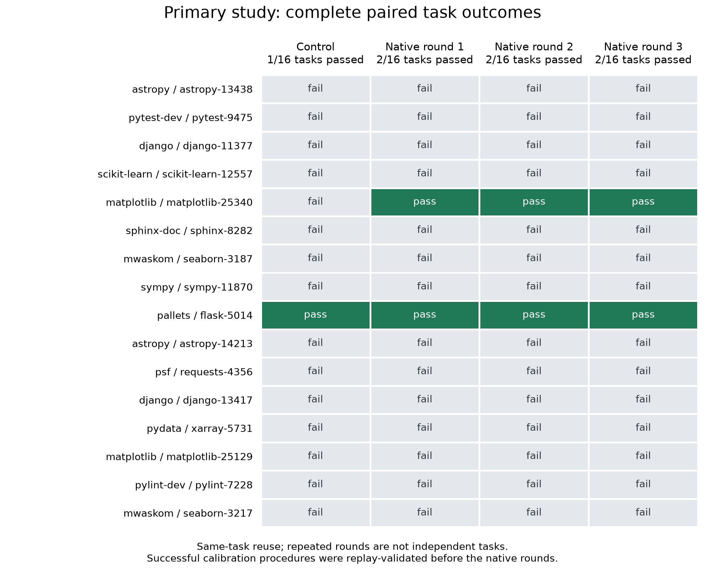

# Completed primary source-learning study

All 64 attempts across 16 fixed tasks have official outcomes. Control solved
1/16 tasks (6.25%); each of the three native rounds solved 2/16 (12.5%). One
additional task passed with native memory, and that gain persisted in all three
rounds. The one passing-control task remained successful in all three rounds.
There are no ungraded attempts or outstanding grading infrastructure failures.

| Condition | Passed tasks | Failed tasks | Gained vs control | Lost vs control |
|---|---:|---:|---:|---:|
| No-memory control | 1 | 15 | — | — |
| Native round 1 | 2 | 14 | 1 | 0 |
| Native round 2 | 2 | 14 | 1 | 0 |
| Native round 3 | 2 | 14 | 1 | 0 |

The additional success is `matplotlib__matplotlib-25340`. The retained control
success is `pallets__flask-5014`. All other tasks failed in every condition.
These two successful procedures originated in the explicitly declared earlier
calibration and were independently replay-validated before reuse. This is
successful automatic acquisition and retention of known working procedures,
not evidence that the failed tasks progressively became solvable, nor a
held-out generalization or underlying reasoning-weight improvement result.
Only one task passed the control, so the absence of observed regressions gives
little evidence about regression safety across successful tasks generally.

Flask produced the same successful patch in all conditions. Its control used
8 calls and about 56 seconds; native rounds used 4–5 calls and about 10–13
seconds. These are whole-agent timings on this task, not isolated memory
application latency. Full patches, trajectories and grader records are retained.

The conditions used 600-second agent budgets, 40 calls, a 512-token response
allowance, an 8192-token context and two concurrent task agents. The original
180-second grading limit was increased to 900 after an independent unchanged-base
SymPy run demonstrated that official grading itself needed about 12 minutes.
The original timeout and successful regrade audit are preserved. Agent budgets
and task outcomes were not changed to accommodate this grading correction.

The final source-delivery audit passed across 1,474 requests, all 64 trajectories
and 39 publications. Complete captured facts match preparation source records
and publication identities, requests use the intended publication, and no text
memory is supplied. This audit verifies source fidelity and routing; it is not
independent proof of tensor semantics or of task accuracy.

The 512-token response cap caused visible truncation, including five consecutive
reproduction-script truncations in Seaborn's control. A separate Pytest native
response repeated “thought” 128 times before recovering valid format on the next
call. Its exact prompt and response hashes are preserved for a queued matched
replay. Neither finding is discarded or converted into a success.

The additional 32-task follow-up is a separate experiment. It uses a larger
1536-token response allowance in both conditions, four independent task pipelines,
and parser-feedback capture for failures that occurred before command execution.
These amendments were recorded before any follow-up attempt; they do not alter
the primary results. The follow-up must be reported separately, and another
attempt alone does not isolate memory's causal effect.

This primary result does not establish broad task improvement or unconditional
release readiness. Exact-candidate serving, preparation, installed-client and
signed lifecycle checks remain separate requirements.

Evidence: [audited outcomes](artifacts/source-learning-20260927/final-primary-report.json),
[complete raw archive](artifacts/source-learning-20260927/complete-primary.tar.gz),
[final delivery audit](artifacts/source-learning-20260927/final-delivery-audit.json),
[checksums](artifacts/source-learning-20260927/SHA256SUMS).
The archive contains 281 individually hashed files, including the executed
source code and preserved interruption evidence. All hashes were checked after
transfer. The plot is reproducible with `benchmarks/swe_learning/plot_primary_results.py`.
